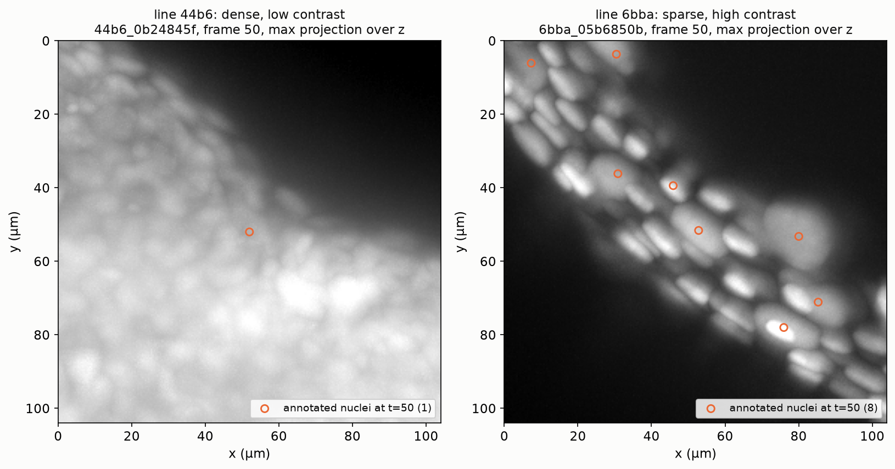
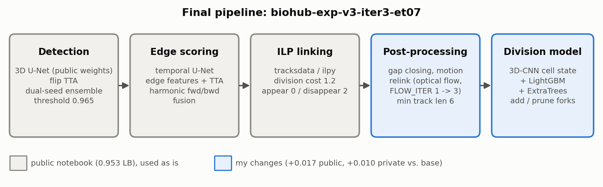
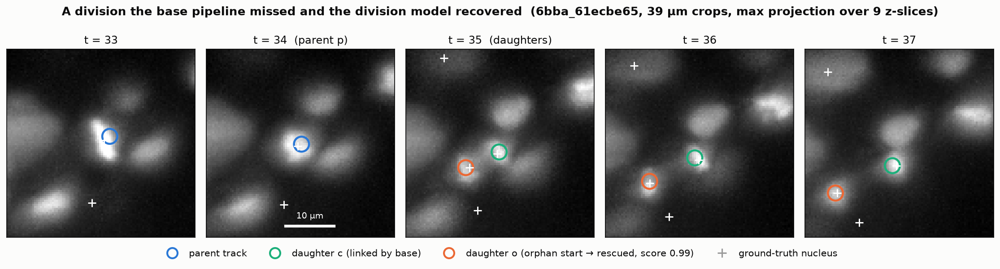
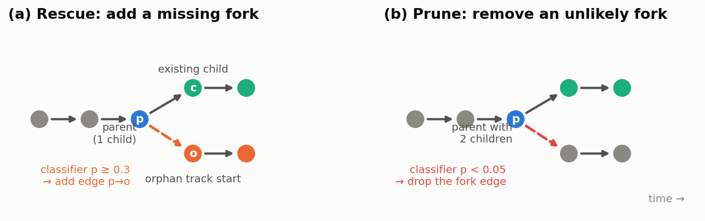
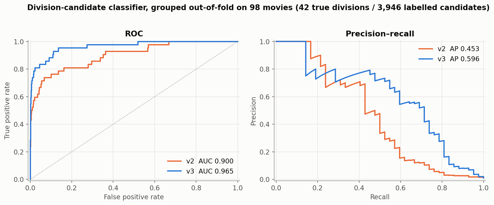
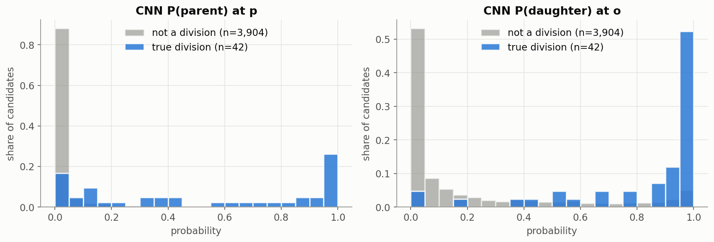
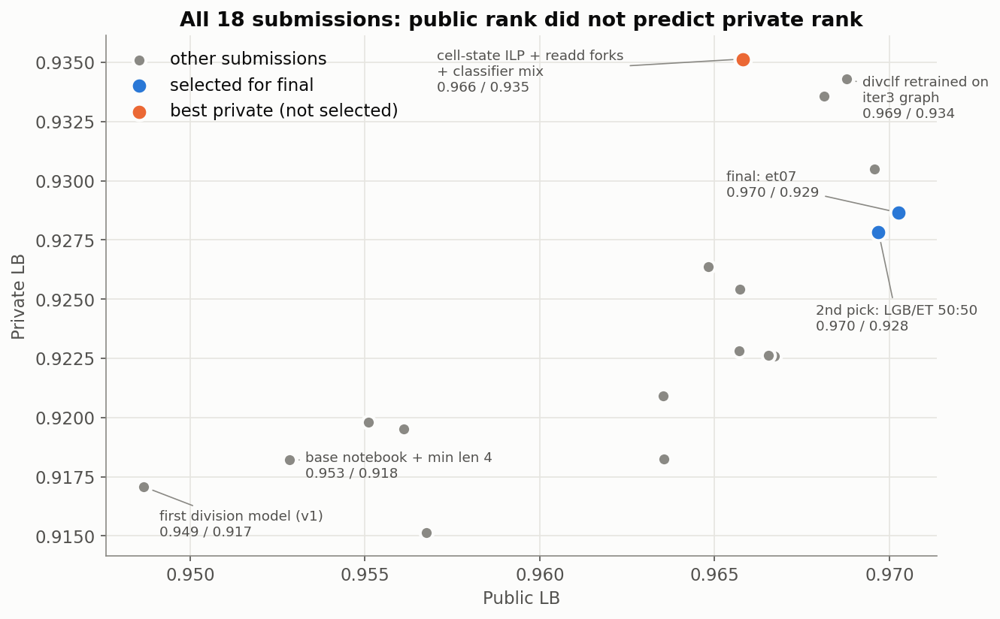
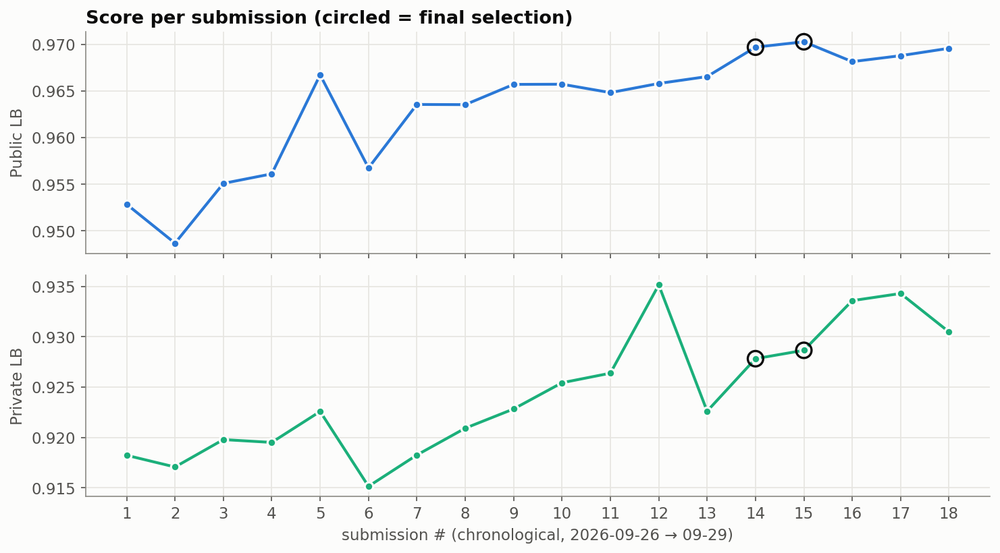

# Learned Division Rescue for 3D Cell Tracking: 91st Place Solution to the Biohub Cell Tracking Competition

## Abstract

We describe a post-hoc division model added to a strong public tracking pipeline for the Kaggle competition *Biohub – Cell Tracking During Development*. Error analysis showed that the base pipeline rarely produces cell divisions: when a cell divides, the parent track usually continues into one daughter, and the second daughter starts an unconnected track. We generate candidate parent–daughter pairs for such orphan track starts and score them with a classifier. Its features are geometry, intensity, temporal context, and the output of a 3D convolutional network trained to recognise parent and daughter cell states. The classifier adds high-confidence missing forks and removes existing forks it rejects. Under grouped out-of-fold validation, the cell-state features raise candidate-level ROC-AUC from 0.900 to 0.965. On the leaderboard, the full method improves the base pipeline by +0.017 (public) and +0.010 (private), reaching 0.929 on the private leaderboard (91st of 3947 teams). We also report a negative result on final-submission selection. Among the top-scoring submissions, public-leaderboard rank was nearly uncorrelated with private rank (Spearman ρ = 0.28). The submissions favoured by grouped out-of-fold validation reached private 0.935, which we did not select.

## 1. Introduction

The task is to reconstruct cell lineages (detections linked over time, including divisions) from 3D time-lapse fluorescence recordings of zebrafish embryos. The evaluation rewards correct links between consecutive frames and, with a smaller weight, correct divisions [3].

Our solution keeps a public pipeline [1, 2] unchanged for detection, linking and most of the post-processing. It adds a learned module that operates on the pipeline's output graph. Our contributions are:

1. an analysis showing that missed divisions follow a consistent "orphan start" pattern in the base pipeline;
2. a division classifier that combines hand-crafted features with probabilities from a 3D-CNN cell-state model, and that can both add and prune forks;
3. an empirical comparison of public-leaderboard selection and out-of-fold selection for final submissions.

## 2. Task and data

### 2.1 Data

The training set contains 199 movies. Each has 100 frames of a 64 × 256 × 256 voxel volume, with a voxel size of 1.625 × 0.406 × 0.406 µm (z, y, x). The movies come from two lines with very different appearance (Figure 1):

- **44b6** (71 movies): dense, low-contrast nuclei;
- **6bba** (128 movies): sparser, elongated, high-contrast nuclei.

Ground truth is a sparse lineage graph. Only a subset of tracks is annotated: about 1% of cells in 44b6 and about 9% in 6bba. All ground-truth edges connect consecutive frames, a cell has at most two children, and the whole training set contains 151 divisions. Daughters move further between frames than other cells (median displacement 5.8 µm per frame vs. 1.8 µm for all edges).

**Figure 1.** One frame of each line (maximum projection over z). Orange circles mark the annotated nuclei in this frame.

### 2.2 Metric

In each frame, predicted nodes are matched to ground-truth nodes by optimal assignment within 7 µm. An edge Jaccard index *J* is then computed over matched edges and adjusted by the predicted node count:

  *J*adj = *J* · (1 − 0.1 · (*N*pred − *T*true) / *T*true),

where *T*true is the estimated total number of cells. The final score is *J*adj + 0.1 · *J*div, where *J*div is the division Jaccard index [3]. Inference runs as a Kaggle code submission on a T4 GPU with a 12-hour limit.

## 3. Base pipeline and failure analysis

### 3.1 Base pipeline

The base is a public notebook that scored 0.953 on the public leaderboard [1]. It uses pretrained weights from [2] (Figure 2):

1. **Detection:** 3D U-Net nucleus detection with flip test-time augmentation and a two-seed ensemble;
2. **Edge scoring:** a temporal U-Net, with forward and backward predictions fused;
3. **Linking:** integer linear programming (ILP);
4. **Post-processing:** gap closing, optical-flow motion relinking, rule-based "safe division" insertion, and short-track filtering.

**Figure 2.** The pipeline. Grey: public components, used unchanged. Blue: components changed or added in this work.

### 3.2 Why divisions fail

We ran the base pipeline on the training movies and matched its output to ground truth. Two observations follow.

- **The ILP almost never forks.** The division cost (1.2) is higher than any single edge probability (≤ 1), so opening a second child is rarely optimal. Most divisions in the output come from the rule-based post-processing, and many true divisions are missed.
- **Missed divisions look the same.** The parent track continues into one daughter, and the other daughter starts a new track nearby. We call this an *orphan start*. Because daughters move fast, the linker drops the parent–daughter edge.

Figure 3 shows a typical case. Recovering the missing edge improves both the division term and the edge term of the metric.

**Figure 3.** A division missed by the base pipeline and recovered by our model. The base pipeline links the parent (blue) only to the green daughter, and the orange daughter starts a new track. Our classifier scores the missing edge at 0.99. White crosses mark ground-truth nuclei; in the ground truth this parent has two children. Crops are 39 µm wide, maximum projection over 9 z-slices.

## 4. Method

### 4.1 Candidate generation

For every orphan start *o* (a node with no predecessor), we consider each node *p* in the previous frame that satisfies all of:

- *p* currently has exactly one child *c*;
- the distance from *p* to *o* is at most 12 µm;
- the distance from *c* to *o* (the sister distance) is at most 18 µm.

Each such triple (*p*, *c*, *o*) is a candidate for **adding** the edge *p* → *o*. Existing forks *p* → (*c*1, *c*2) are scored the same way, with *o* set to the farther child. These are candidates for **pruning** (Figure 4).

**Figure 4.** The two operations of the division model: (a) adding a missing fork to an orphan start, and (b) pruning a fork that the classifier rejects.

### 4.2 Features

Each candidate is described by 36 features:

- **Geometry:** distances *p*–*o*, *p*–*c* and *c*–*o*; the offset of *p* from the midpoint of the two daughters; symmetry; the angle between the daughters' displacement vectors; track lengths before and after the event; parent speed; depth *z*.
- **Intensity:** maximum, centre and fill statistics of *p*, *c* and *o*, and daughter–daughter and parent–daughter ratios. A dividing nucleus brightens and condenses, and the daughters are dimmer.
- **Temporal context:** the same intensity statistics for the predecessor of *p* and the successors of *c* and *o*.
- **Cell state:** probabilities from the 3D-CNN of Section 4.3. These are P(parent) for *p* and its predecessor, and P(daughter) and P(parent) for *c* and *o*.

### 4.3 3D-CNN cell-state model

Following the use of learned cell-state classifiers in lineage tracking [4, 5], we train a network to classify a detected nucleus as *continuing*, *parent* (it divides in the next frame) or *daughter* (it was just born).

- **Input:** three consecutive frames (*t* − 1, *t*, *t* + 1), stacked as channels. Each is a 7 × 32 × 32 voxel patch (about 11 × 13 × 13 µm) centred on the nucleus and normalised with the movie's 1% and 99.9% intensity quantiles.
- **Architecture:** a small 3D ResNet [6] with four residual blocks (width 24 → 96), global average pooling and three outputs.
- **Labels:** from the ground-truth graphs. Nodes with two children are parents, their children are daughters, and all other annotated nodes are continuing.
- **Training:** flips along x, y and z, x–y transposition, and random intensity scaling. On held-out movies, parent-versus-rest ROC-AUC is 0.97.
- **Inference:** the model is evaluated only at candidate nodes, in fp16.

### 4.4 Classifier and decision rule

**Labels.** Candidate labels come from matching the base pipeline's output on the training movies to ground truth with the 7 µm criterion of the metric:

- positive: *p* matches a ground-truth node with two children, and *o* matches one of those children;
- negative: *p* matches a ground-truth node with one child;
- unlabelled: no match.

This gives 3,946 labelled candidates, only 42 of them positive.

**Models.**

- LightGBM [7]: 200 trees, 7 leaves, positive-class weight 20, averaged over 3 seeds.
- ExtraTrees [8]: 400 trees, minimum leaf size 3, balanced class weights. For inference we export the forest to plain numpy arrays, which removes any dependency on the scikit-learn version. The numpy predictions match scikit-learn exactly.

The final score is 0.3 × LightGBM + 0.7 × ExtraTrees.

**Decision rule.**

- A missing fork *p* → *o* is **added** if the score is at least 0.3.
- An existing fork is **pruned** (the edge to the farther child is removed) if its score is below 0.05.

## 5. Experiments

### 5.1 Validation protocol

The base pipeline's detector and linker were trained on all training movies, so local edge scores are optimistic. The division classifier, however, can be evaluated honestly. We use grouped 5-fold cross-validation by movie on 98 movies and report out-of-fold (OOF) predictions.

### 5.2 Classifier performance

Adding the cell-state features raises candidate-level ROC-AUC from 0.900 to 0.965 and average precision from 0.453 to 0.596 (Figure 5). The CNN probabilities alone already separate most true divisions from look-alike candidates (Figure 6).

**Figure 5.** Out-of-fold ROC and precision–recall curves of the division classifier with (v3) and without (v2) cell-state features.

**Figure 6.** Distribution of CNN probabilities for labelled candidates. Left: P(parent) at *p*. Right: P(daughter) at *o*.

### 5.3 End-to-end results

Table 1 lists the main stages. Local scores are full-pipeline OOF scores on 98 movies.

**Table 1.** Results by stage.

| Stage | Local OOF | Public | Private |
|---|---|---|---|
| Base pipeline (min. track length 4) | 0.9231 | 0.953 | 0.918 |
| + division model v1 (geometry, intensity) | – | 0.949 | 0.917 |
| + v2 (temporal features) | 0.9316 | 0.955 | 0.920 |
| + v3 (cell-state features, pruning at 0.05) | 0.9396 | 0.967 | 0.923 |
| + 3 optical-flow iterations in motion relinking | – | 0.967 | 0.923 |
| + LightGBM/ExtraTrees blend, add threshold 0.3 (**final**) | – | **0.970** | **0.929** |

Two observations:

- **v1 hurt the score.** Most orphan starts in unseen data are linking failures, not divisions, so an imprecise classifier adds many false forks. The gains appeared only once the classifier was precise (v3) and the add threshold was conservative.
- **Relinking alone did nothing.** Three optical-flow iterations changed the score by less than 0.001 on its own; most of the final gain came from the classifier blend and threshold.

### 5.4 Negative results

- **Pipeline parameters:** tuning the detection threshold, ILP appearance, disappearance and division weights, minimum track length, and safe-division parameters gave no reliable gain.
- **Detection:** retraining the detector was not feasible in the available time, and re-adding low-confidence detections did not help.
- **Cell-state ILP:** we injected the cell-state probabilities into the ILP, lowering the division cost for likely parents and adding a bonus to parent–daughter edges. This was the best variant locally (+0.024), but it changed thousands of edges per movie and lowered the public score (0.965). A variant that keeps motion relinking and re-adds ILP forks afterwards ("readd") scored 0.966 public and **0.935 private**, the best private score among our submissions (Section 6).
- **Re-linking stolen daughters:** daughters that the ILP had linked to a neighbouring track were too hard to identify precisely.
- **Five-frame CNN input:** no gain over three frames.

## 6. Final submission selection

We selected the two submissions with the highest public scores. Over all 18 submissions, public and private scores are strongly rank-correlated (Spearman ρ = 0.81). Among the 10 submissions with public ≥ 0.965, however, the correlation is only ρ = 0.28 (p = 0.43) (Figures 7 and 8).

**Table 2.** Top submissions: selected vs. best private.

| Submission | Public | Private | Selected |
|---|---|---|---|
| v3 + relink + LGB/ET 30:70 (final) | **0.970** | 0.929 | ✓ |
| v3 + relink + LGB/ET 50:50 | 0.970 | 0.928 | ✓ |
| classifier retrained on the relinked graph (50:50) | 0.969 | 0.934 | |
| cell-state ILP + readd + classifier mix | 0.966 | **0.935** | |

The two best private submissions were also the best under honest validation:

- **Cell-state ILP + readd + classifier mix:** OOF 0.948 vs. 0.940 for v3.
- **Classifier retrained on the relinked graph:** bootstrap probability of improvement 0.99.

Selecting by OOF would have placed us at about rank 49 instead of 91.

**Figure 7.** Public vs. private score for all 18 submissions.

**Figure 8.** Public (top) and private (bottom) score per submission in chronological order. Circles mark the final selection.

## 7. Discussion

- **Division changes transferred; link changes did not.** Division-side improvements measured by grouped OOF transferred to the leaderboard. Link-side changes that looked good locally mostly did not, because the base models had seen all training movies.
- **Pruning made the model low-risk.** A post-hoc model that can also remove structure it does not believe is safer than one that only adds. In our experiments, pruning at 0.05 was consistently safe.
- **Public-leaderboard differences were noise.** In the 0.965–0.970 band, public differences of 0.001–0.003 did not carry over to the private leaderboard. Final submissions should be chosen by trusted validation, and the two picks should differ from each other; ours were nearly the same model.
- **Limitations.** The positive class is very small (42 labelled divisions), the detector and linker were not retrained, and local edge scores remain in-sample.

## 8. Conclusion

A division classifier built on 3D-CNN cell-state probabilities, applied after a fixed public tracking pipeline, recovers missed divisions and removes false ones. It improves the private score from 0.918 to 0.929. In hindsight, the larger remaining gain was in final-submission selection: trusting grouped out-of-fold validation over the public leaderboard would have yielded 0.935.

## References

1. anvithpothula. "Biohub 0.953 LB | ORIGINAL." Kaggle Notebook. https://www.kaggle.com/code/anvithpothula/biohub-0-953-lb-original ; dataset "biohub v1284 head s075." https://www.kaggle.com/datasets/anvithpothula/biohub-v1284-head-s075
2. P. Kim (pilkwang). Kaggle datasets "Biohub DeepCenterUNet3D Center Prior V1" (https://www.kaggle.com/datasets/pilkwang/biohub-deepcenter-unet3d-center-prior-v1), "Biohub TemporalUNet3D Seed 314159 V1" (https://www.kaggle.com/datasets/pilkwang/biohub-temporal-unet3d-seed314159-v1), and "Biohub Tracking Support Pack" (https://www.kaggle.com/datasets/pilkwang/biohub-tracking-support-pack-50ep-v1).
3. Royer Lab. Kaggle cell tracking competition baseline and metric. https://github.com/royerlab/kaggle-cell-tracking-competition
4. C. Malin-Mayor et al. "Automated reconstruction of whole-embryo cell lineages by learning from sparse annotations." *Nature Biotechnology* 41, 44–49 (2023). https://doi.org/10.1038/s41587-022-01427-7
5. P. Hirsch et al. "Tracking by weakly-supervised learning and graph optimization for whole-embryo C. elegans lineages." MICCAI 2022, LNCS 13434, 25–35. https://arxiv.org/abs/2208.11467
6. K. He, X. Zhang, S. Ren, J. Sun. "Deep residual learning for image recognition." CVPR 2016.
7. G. Ke et al. "LightGBM: A highly efficient gradient boosting decision tree." NeurIPS 2017.
8. P. Geurts, D. Ernst, L. Wehenkel. "Extremely randomized trees." *Machine Learning* 63, 3–42 (2006).
