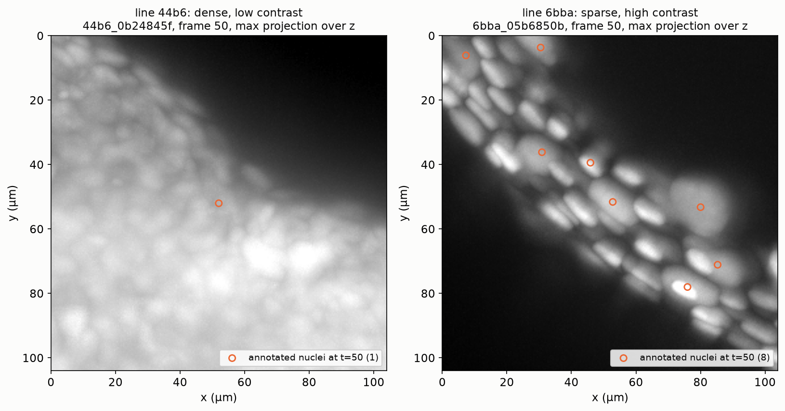
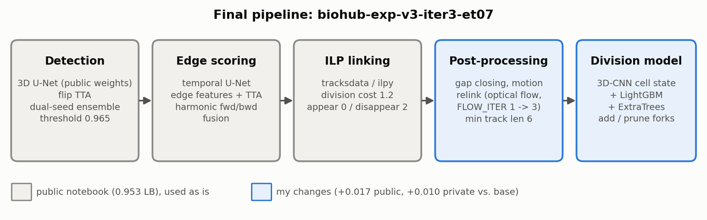
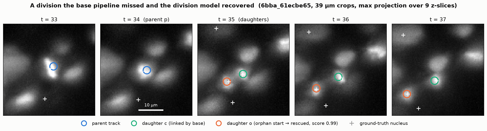
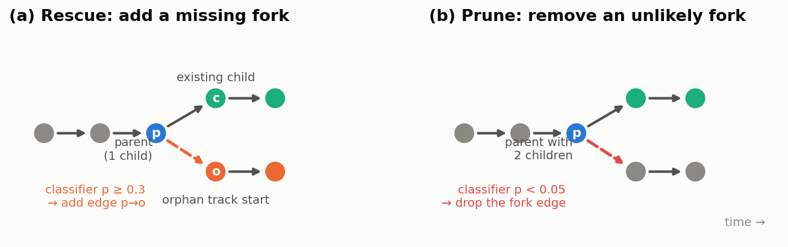
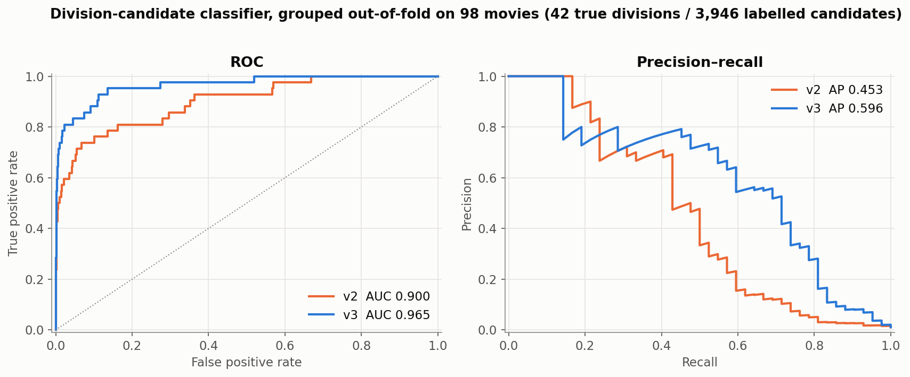
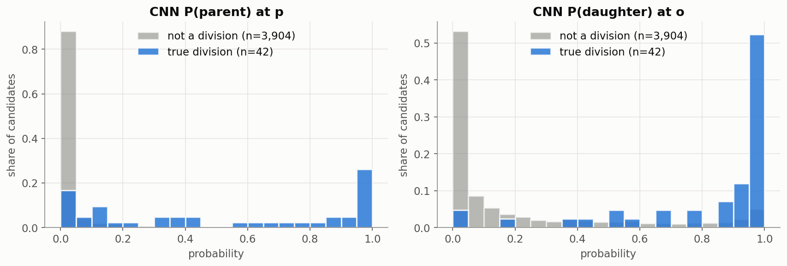
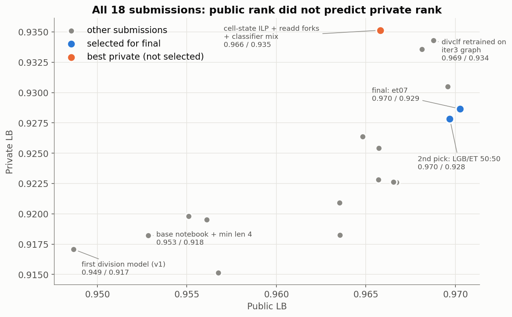
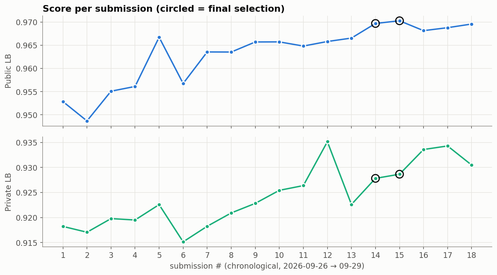

# 3D 細胞追跡における学習ベースの分裂補完：Biohub Cell Tracking コンペ 91位解法

## 概要

Kaggle コンペ *Biohub – Cell Tracking During Development* において、強力な公開追跡パイプラインの後段に分裂モデルを追加した手法を報告する。誤差分析の結果、ベースパイプラインは細胞分裂をほとんど出力しないことが分かった。細胞が分裂すると、親のトラックは一方の娘に続き、もう一方の娘はどこにもつながらない新しいトラックとして始まることが多い。本手法では、このような孤立したトラック始点に対して親・娘の候補ペアを生成し、分類器で採点する。分類器の特徴量は、幾何、輝度、時間方向の文脈、および親・娘の細胞状態を識別するよう学習した 3D 畳み込みネットワークの出力である。分類器は確信度の高い欠落フォーク（分岐）を追加し、既存のフォークのうち否定したものを除去する。動画単位のグループ out-of-fold 検証で、細胞状態の特徴量は候補レベルの ROC-AUC を 0.900 から 0.965 に向上させた。リーダーボードでは、ベースパイプラインに対して Public +0.017、Private +0.010 の改善となり、Private 0.929（3947チーム中91位）を得た。あわせて、最終提出の選択に関する否定的な結果を報告する。上位の提出群では、Public の順位と Private の順位はほぼ無相関であった（Spearman ρ = 0.28）。グループ out-of-fold 検証で優れていた提出は Private 0.935 に達していたが、最終提出には選択していなかった。

## 1. はじめに

本タスクは、ゼブラフィッシュ胚の 3D タイムラプス蛍光画像から細胞系譜（時間方向に連結された検出結果。分裂を含む）を再構成するものである。評価は連続フレーム間の正しいリンクを重視し、正しい分裂にも小さな重みを与える [3]。

本解法では、検出、リンク、および後処理の大部分について公開パイプライン [1, 2] を変更せずに用いる。その出力グラフに対して作用する学習モジュールを追加する。本解法の貢献は次のとおりである。

1. ベースパイプラインで見逃される分裂が、一貫した「孤立始点」のパターンを示すことの分析
2. 手作りの特徴量と 3D-CNN 細胞状態モデルの確率を組み合わせ、フォークの追加と除去の両方を行う分裂分類器
3. 最終提出の選択について、Public リーダーボードによる選択と out-of-fold 検証による選択の実証的な比較

## 2. タスクとデータ

### 2.1 データ

学習データは 199 本の動画からなる。各動画は 64 × 256 × 256 ボクセルのボリューム 100 フレームで、ボクセルサイズは 1.625 × 0.406 × 0.406 µm（z, y, x）である。動画は見た目が大きく異なる2つの系統から得られている（図1）。

- **44b6**（71本）：核が密でコントラストが低い。
- **6bba**（128本）：核がまばらで細長く、コントラストが高い。

正解は疎な系譜グラフであり、注釈されているのは一部のトラックのみである（細胞のうち 44b6 で約1%、6bba で約9%）。正解のエッジはすべて連続フレーム間を結び、各細胞の子は最大2つ、学習データ全体の分裂数は 151 である。娘細胞はフレーム間の移動量が大きい（1フレームあたりの移動量の中央値は、娘細胞が 5.8 µm、全エッジでは 1.8 µm）。

**図1.** 各系統の1フレーム（z 方向の最大値投影）。オレンジの円はこのフレームで注釈されている核を示す。

### 2.2 評価指標

各フレームで、予測ノードと正解ノードを 7 µm 以内の最適割当で対応付ける。対応付いたエッジについてエッジ Jaccard 指数 *J* を計算し、予測ノード数で補正する。

  *J*adj = *J* · (1 − 0.1 · (*N*pred − *T*true) / *T*true)

ここで *T*true は推定される全細胞数である。最終スコアは *J*adj + 0.1 · *J*div で、*J*div は分裂の Jaccard 指数である [3]。推論は Kaggle のコード提出として、T4 GPU 上で 12 時間の制限内で実行する。

## 3. ベースパイプラインと失敗の分析

### 3.1 ベースパイプライン

ベースには Public リーダーボードで 0.953 を記録した公開ノートブック [1] を用い、その学習済み重みは [2] による（図2）。

1. **検出：** 3D U-Net による核検出。反転によるテスト時拡張と、2シードのアンサンブルを用いる。
2. **エッジスコア：** temporal U-Net。順方向と逆方向の予測を融合する。
3. **リンク：** 整数線形計画法（ILP）。
4. **後処理：** ギャップの補完、オプティカルフローによるモーションリリンク、ルールベースの分裂挿入（"safe division"）、短いトラックの除去。

**図2.** パイプラインの全体像。灰色は変更せずに用いた公開部分、青は本研究で変更・追加した部分。

### 3.2 分裂が失敗する理由

学習動画に対してベースパイプラインを実行し、出力を正解と対応付けたところ、次の2点が分かった。

- **ILP はほとんど分岐しない。** 分裂コスト（1.2）がどのエッジ確率（≤ 1）よりも大きいため、2つ目の子を張ることはほぼ最適にならない。出力に含まれる分裂の大半はルールベースの後処理によるもので、本物の分裂の多くが見逃されている。
- **見逃された分裂は同じ形をしている。** 親のトラックが一方の娘に続き、もう一方の娘は近くで新しいトラックとして始まる。これを **孤立始点** と呼ぶ。娘細胞は移動が速いため、リンカーは親から娘へのエッジを落としてしまう。

典型例を図3に示す。欠落したエッジを復元すると、評価指標の分裂の項とエッジの項の両方が改善する。

**図3.** ベースパイプラインが見逃し、本モデルが復元した分裂。ベースパイプラインは親（青）を緑の娘にしかつないでおらず、オレンジの娘は新しいトラックとして始まっている。本分類器は欠落したエッジを 0.99 と採点した。白い十字は正解の核で、正解グラフでもこの親は2つの子を持つ。切り出し幅は 39 µm、9 枚の z スライスの最大値投影。

## 4. 手法

### 4.1 候補の生成

各孤立始点 *o*（先行ノードを持たないノード）について、直前フレームのノード *p* のうち次の条件をすべて満たすものを考える。

- *p* が現在ちょうど1つの子 *c* を持つ。
- *p* と *o* の距離が 12 µm 以内。
- *c* と *o* の距離（姉妹間距離）が 18 µm 以内。

このような三つ組（*p*, *c*, *o*）は、エッジ *p* → *o* を **追加** する候補となる。既存のフォーク *p* → (*c*1, *c*2) も、遠いほうの子を *o* として同様に採点し、**除去** の候補とする（図4）。

**図4.** 分裂モデルの2つの操作。(a) 孤立始点への欠落フォークの追加。(b) 分類器が否定したフォークの除去。

### 4.2 特徴量

各候補を 36 個の特徴量で表す。

- **幾何：** *p*–*o*、*p*–*c*、*c*–*o* の距離、2つの娘の中点から *p* までのずれ、対称性、娘同士の変位ベクトルのなす角、分裂前後のトラック長、親の速度、深さ *z*。
- **輝度：** *p*、*c*、*o* の最大値・中心値・充填率の統計量、および娘同士・親と娘の比。分裂する核は明るく凝縮し、娘は暗くなる。
- **時間方向の文脈：** *p* の先行ノードと、*c* および *o* の後続ノードについての同じ輝度統計量。
- **細胞状態：** 4.3節の 3D-CNN の確率。*p* とその先行ノードの P(親)、*c* と *o* の P(娘) と P(親)。

### 4.3 3D-CNN 細胞状態モデル

系譜追跡で学習ベースの細胞状態分類器が用いられていること [4, 5] にならい、検出された核を **継続**、**親**（次のフレームで分裂する）、**娘**（分裂直後）の3クラスに分類するネットワークを学習する。

- **入力：** 連続する3フレーム（*t* − 1, *t*, *t* + 1）をチャンネルとして重ねたもの。各フレームは核を中心とした 7 × 32 × 32 ボクセルのパッチ（約 11 × 13 × 13 µm）で、動画ごとの輝度の 1% 分位点と 99.9% 分位点で正規化する。
- **構造：** 小規模な 3D ResNet [6]。残差ブロック4つ（幅 24 → 96）、global average pooling、3出力。
- **ラベル：** 正解グラフから作成する。子を2つ持つノードを親、その子を娘、それ以外の注釈ノードを継続とする。
- **学習：** x / y / z 方向の反転、x–y の転置、輝度のランダムなスケーリングによるデータ拡張を用いる。学習に用いていない動画での、親とそれ以外の判別 ROC-AUC は 0.97 である。
- **推論：** 候補ノードに対してのみ、fp16 で評価する。

### 4.4 分類器と判定規則

**ラベル。** 学習動画に対するベースパイプラインの出力を、評価指標と同じ 7 µm の基準で正解と対応付け、候補にラベルを付ける。

- 正例：*p* が子を2つ持つ正解ノードに対応し、*o* がその子の一方に対応する。
- 負例：*p* が子を1つ持つ正解ノードに対応する。
- ラベルなし：対応が取れない。

これによりラベル付きの候補は 3,946 件となり、そのうち正例はわずか 42 件である。

**モデル。**

- LightGBM [7]：200本、葉7、正例の重み 20、3シードの平均。
- ExtraTrees [8]：400本、最小葉サイズ 3、クラス重み balanced。推論時は森を numpy 配列として書き出し、scikit-learn のバージョンへの依存をなくした。numpy による予測は scikit-learn と完全に一致する。

最終スコアは 0.3 × LightGBM + 0.7 × ExtraTrees とする。

**判定規則。**

- スコアが 0.3 以上なら、欠落フォーク *p* → *o* を **追加** する。
- 既存フォークのスコアが 0.05 未満なら、そのフォークを **除去** する（遠いほうの子へのエッジを削除する）。

## 5. 実験

### 5.1 検証方法

ベースパイプラインの検出器とリンカーは全学習動画で学習されているため、ローカルのエッジスコアは楽観的になる。一方、分裂分類器は公正に評価できる。98 本の動画で動画単位のグループ 5-fold 交差検証を行い、out-of-fold（OOF）予測で評価する。

### 5.2 分類器の性能

細胞状態の特徴量を加えると、候補レベルの ROC-AUC は 0.900 から 0.965 に、平均適合率（AP）は 0.453 から 0.596 に向上した（図5）。CNN の確率だけでも、本物の分裂と紛らわしい候補の大部分を分離できている（図6）。

**図5.** 細胞状態の特徴量あり（v3）となし（v2）の分裂分類器の、out-of-fold での ROC 曲線と適合率–再現率曲線。

**図6.** ラベル付き候補における CNN の確率の分布。左：*p* での P(親)。右：*o* での P(娘)。

### 5.3 パイプライン全体での結果

主な段階ごとの結果を表1に示す。ローカルスコアは、98 本の動画に対するパイプライン全体の OOF スコアである。

**表1.** 段階ごとの結果。

| 段階 | ローカル OOF | Public | Private |
|---|---|---|---|
| ベースパイプライン（最小トラック長 4） | 0.9231 | 0.953 | 0.918 |
| + 分裂モデル v1（幾何、輝度） | – | 0.949 | 0.917 |
| + v2（時間方向の特徴量） | 0.9316 | 0.955 | 0.920 |
| + v3（細胞状態の特徴量、0.05 での除去） | 0.9396 | 0.967 | 0.923 |
| + モーションリリンクのオプティカルフロー反復を 3 回に | – | 0.967 | 0.923 |
| + LightGBM/ExtraTrees のブレンド、追加閾値 0.3（**最終**） | – | **0.970** | **0.929** |

ここから次の2点が分かる。

- **v1 はスコアを下げた。** 未知データの孤立始点の大半は分裂ではなくリンクの失敗であり、精度の低い分類器は誤ったフォークを大量に追加してしまう。改善が得られたのは、分類器が十分に正確になり（v3）、追加の閾値を保守的にしてからであった。
- **リリンクの変更は単独では効果がなかった。** オプティカルフロー反復を 3 回にする変更は、単独ではスコアを 0.001 未満しか変えなかった。最終的な改善の大部分は、分類器のブレンドと閾値によるものである。

### 5.4 効果のなかった試み

- **パイプラインのパラメータ：** 検出閾値、ILP の出現・消失・分裂の重み、最小トラック長、safe division のパラメータを調整したが、安定した改善は得られなかった。
- **検出：** 期間内に検出器を再学習することはできず、信頼度の低い検出を再び加える方法も効果がなかった。
- **細胞状態 ILP：** 細胞状態の確率を ILP に組み込み、親らしい細胞の分裂コストを下げ、親から娘へのエッジにボーナスを与えた。ローカルでは最良（+0.024）だったが、動画ごとに数千本のエッジを変え、Public スコアは下がった（0.965）。モーションリリンクを残し、ILP のフォークを後から戻す変種（"readd"）は Public 0.966 だったが、**Private 0.935** で、全提出の中で最も高い Private スコアとなった（6章）。
- **奪われた娘のつなぎ直し：** ILP が隣のトラックにつないでしまった娘を、十分な精度で特定することができなかった。
- **5フレーム入力の CNN：** 3フレームに比べて改善しなかった。

## 6. 最終提出の選択

最終提出には、Public スコアが最も高い2本を選んだ。全 18 本の提出では Public と Private の順位相関は高い（Spearman ρ = 0.81）。しかし Public 0.965 以上の 10 本に限ると、相関は ρ = 0.28（p = 0.43）にとどまる（図7、図8）。

**表2.** 上位の提出：選択したものと Private 最高のもの。

| 提出 | Public | Private | 選択 |
|---|---|---|---|
| v3 + リリンク + LGB/ET 30:70（最終） | **0.970** | 0.929 | ✓ |
| v3 + リリンク + LGB/ET 50:50 | 0.970 | 0.928 | ✓ |
| リリンク後のグラフで再学習した分類器（50:50） | 0.969 | 0.934 | |
| 細胞状態 ILP + readd + 分類器のミックス | 0.966 | **0.935** | |

Private で最も良かった2本は、公正な検証でも最良であった。

- **細胞状態 ILP + readd + 分類器のミックス：** OOF 0.948（v3 は 0.940）。
- **リリンク後のグラフで再学習した分類器：** ブートストラップでの改善確率 0.99。

OOF で選んでいれば、順位は 91 位ではなく 49 位前後であった。

**図7.** 全 18 本の提出の Public スコアと Private スコア。

**図8.** 提出ごとの Public スコア（上）と Private スコア（下）を時系列順に示す。丸印は最終選択。

## 7. 考察

- **分裂側の改善は転移し、リンク側の改善は転移しなかった。** グループ OOF で測った分裂側の改善はリーダーボードに転移した。一方、ローカルで良く見えたリンク側の変更はほとんど転移しなかった。ベースのモデルが全学習動画を学習済みだったためである。
- **除去の操作がモデルを低リスクにした。** 信じない構造を除去することもできる後付けモデルは、追加しかしないモデルよりも安全である。実験の範囲では、0.05 での除去は一貫して安全であった。
- **Public リーダーボードの差はノイズだった。** 0.965〜0.970 の範囲では、Public での 0.001〜0.003 の差は Private に引き継がれなかった。最終提出は信頼できる検証で選び、2本は互いに性質の異なるものにすべきである。本解法の2本はほぼ同じモデルであった。
- **限界。** 正例が非常に少なく（ラベル付きの分裂は 42 件）、検出器とリンカーは再学習しておらず、ローカルのエッジスコアは in-sample のままである。

## 8. 結論

3D-CNN の細胞状態確率に基づく分裂分類器を、固定した公開追跡パイプラインの後段に適用すると、見逃された分裂を復元し、誤った分裂を除去できる。この手法により Private スコアは 0.918 から 0.929 に向上した。振り返ると、残されていたより大きな改善余地は最終提出の選択にあった。Public リーダーボードよりもグループ out-of-fold 検証を信頼していれば、0.935 が得られていた。

## 参考文献

1. anvithpothula. "Biohub 0.953 LB | ORIGINAL." Kaggle Notebook. https://www.kaggle.com/code/anvithpothula/biohub-0-953-lb-original ; dataset "biohub v1284 head s075." https://www.kaggle.com/datasets/anvithpothula/biohub-v1284-head-s075
2. P. Kim (pilkwang). Kaggle datasets "Biohub DeepCenterUNet3D Center Prior V1" (https://www.kaggle.com/datasets/pilkwang/biohub-deepcenter-unet3d-center-prior-v1), "Biohub TemporalUNet3D Seed 314159 V1" (https://www.kaggle.com/datasets/pilkwang/biohub-temporal-unet3d-seed314159-v1), and "Biohub Tracking Support Pack" (https://www.kaggle.com/datasets/pilkwang/biohub-tracking-support-pack-50ep-v1).
3. Royer Lab. Kaggle cell tracking competition baseline and metric. https://github.com/royerlab/kaggle-cell-tracking-competition
4. C. Malin-Mayor et al. "Automated reconstruction of whole-embryo cell lineages by learning from sparse annotations." *Nature Biotechnology* 41, 44–49 (2023). https://doi.org/10.1038/s41587-022-01427-7
5. P. Hirsch et al. "Tracking by weakly-supervised learning and graph optimization for whole-embryo C. elegans lineages." MICCAI 2022, LNCS 13434, 25–35. https://arxiv.org/abs/2208.11467
6. K. He, X. Zhang, S. Ren, J. Sun. "Deep residual learning for image recognition." CVPR 2016.
7. G. Ke et al. "LightGBM: A highly efficient gradient boosting decision tree." NeurIPS 2017.
8. P. Geurts, D. Ernst, L. Wehenkel. "Extremely randomized trees." *Machine Learning* 63, 3–42 (2006).
